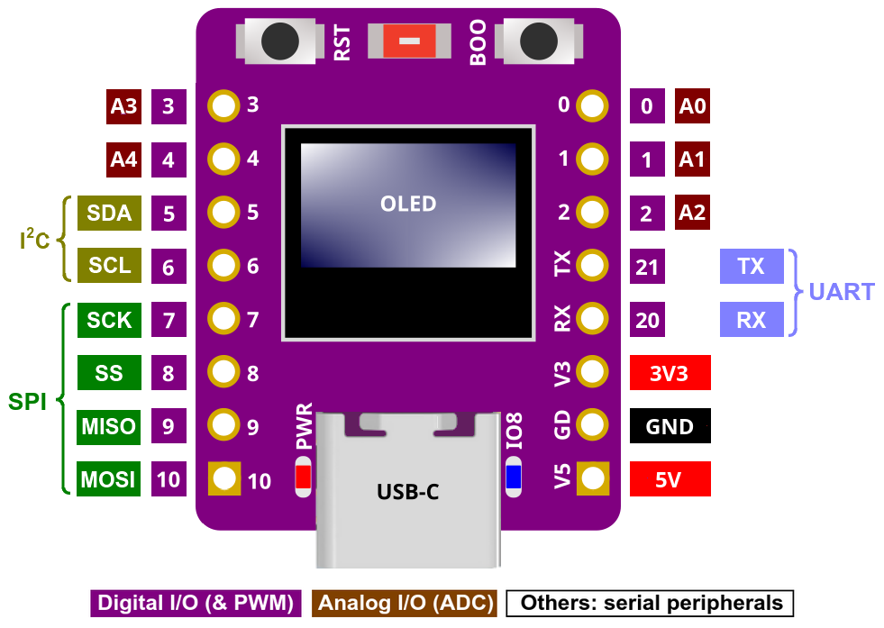

# 房间温湿度计 · ESP32-C3 72×40 OLED

每个房间一块开发板。每秒读取 SHT3x 并显示温湿度，通过手机配置 Wi-Fi、房间名及接口服务，默认每 60 秒上传一组最新读数。接口服务由用户提供，本项目不搭建服务端。

## 硬件与接线

### 本项目使用的硬件

| 部件 | 规格与用途 |
| --- | --- |
| 主控开发板 | ESP32-C3，带 USB-C、板载 OLED、RST 复位键和 BOOT 下载/配置键；下图为本项目使用的引脚参考图。图片未注明厂家及完整型号，购买时需核对屏幕和引脚，不能仅凭“C3 Mini”名称判断兼容性。 |
| 板载屏幕 | 本项目已确认使用 **0.42 寸、72×40 像素 OLED**（此前口述为 0.47 寸，以确认的分辨率为准）；代码使用 SSD1306 的 `U8G2_SSD1306_72X40_ER_F_HW_I2C` 驱动处理显存偏移。不是另一份 `c3_mini_pro_temperature` 项目的 128×64 屏幕。 |
| 温湿度传感器 | **SHT3x I2C 温湿度传感器模块**，代码使用 Sensirion 官方 SHT3x 库；本项目按 SDA、SCL、VCC、GND 四线连接。具体子型号以模块丝印为准。 |
| 供电与下载 | USB-C 数据线连接电脑，用于供电、固件上传和串口日志；仅能充电的线不能用于上传。 |
| 连接材料 | 与板子/模块排针匹配的杜邦线或焊接导线，共 4 根。 |

### 开发板引脚参考图



图片由用户提供，作为接线定位参考。**以屏幕正面朝向自己、USB-C 接口朝下**观察：左侧标注 `5`、`6` 的引脚分别用于 SDA、SCL；右侧 `V3 / 3V3` 是 3.3V，`GD / GND` 是地。图中的 `5` 表示 **GPIO5**，不是 5V，也不是从上往下数的第 5 个孔；供电 `5V` 在右侧底部。

| 图中标注 | 含义 | 本项目用途 |
| --- | --- | --- |
| `5 / SDA` | GPIO5，I2C Serial Data（串行数据线） | 板载 OLED 和外接 SHT3x 共用 |
| `6 / SCL` | GPIO6，I2C Serial Clock（串行时钟线） | 板载 OLED 和外接 SHT3x 共用 |
| `V3 / 3V3` | 3.3V 电源 | 接传感器 VCC |
| `GD / GND` | Ground（公共地） | 接传感器 GND |
| `V5 / 5V` | 5V 电源引脚 | 本项目用 USB-C 供电，传感器接 3V3，不接这里 |
| `RST` | Reset（复位）按钮 | 重启程序；配合 BOOT 进入下载模式 |
| `BOO / BOOT` | 启动/下载按钮 | 当前代码按 GPIO9、低电平按下处理；运行时长按 3 秒打开手机配置热点 |
| `TX / 21`、`RX / 20` | UART 串口发送/接收引脚 | 本项目不需要外接这两根线，直接通过 USB-C 下载和查看日志 |
| `SCK / 7`、`SS / 8`、`MISO / 9`、`MOSI / 10` | 图示 SPI 信号分配 | 本项目没有使用 SPI；这些标注不表示温湿度传感器应连接到这里 |
| `A0–A4`、其他数字 | 图示模拟输入别名及 GPIO 编号 | 本项目未使用 |

图上蓝色指示灯标注 `IO8`，不要把它误认为 BOOT 按键的引脚。BOOT 的 GPIO9 是本项目现有代码配置，图片本身没有画出按键的内部连线；更换开发板版本时，应核对厂家原理图与代码。

### SHT3x 四线连接表

先断开 USB 电源，再按下面连接；**代码中的 GPIO 编号必须与实际接线一致**。

| SHT3x 模块端 | ESP32-C3 开发板端 | 作用 |
| --- | --- | --- |
| `VCC`（有的模块标 `VIN`） | **3V3 / V3** | 给传感器供电，本项目使用 3.3V |
| `GND` | **GND / GD** | 共地 |
| `SDA` | **GPIO5** | 温湿度数据线 |
| `SCL` | **GPIO6** | I2C 时钟线 |

这里的接线针对带排针/焊盘的传感器模块，不是裸芯片封装。若模块有其他引脚，按其具体型号说明处理，本项目只使用上述四根线。板载 OLED 已在开发板内部接线，不需要另外接屏幕电源或信号线。

OLED 与 SHT3x 共用同一组 GPIO5/6，通过不同 I2C 地址区分设备。本项目启动日志已检测到 OLED **`0x3C`**、SHT3x **`0x44`**；程序也会探测 SHT3x 的 **`0x45`** 地址。地址是总线上的设备标识，不是 GPIO 编号。请勿将 SDA/SCL 接到 5V；这里使用 3.3V 供电与逻辑电平。

Wi-Fi 工作会使开发板发热，SHT3x 应与主控、OLED 和其他热源保持距离，并让感测位置通风，避免把板上温升当成室温。

### 接好后检查

1. USB-C 连接电脑并上传固件；正常运行时 OLED 显示温度、湿度，`LIVE` 计数持续增加。
2. 打开 115200 波特率串口，检查 `I2C found: 0x3C` 和 `I2C found: 0x44`（传感器也可能为 `0x45`），以及连续的 `Temperature` / `Humidity` 日志。
3. 若显示 `SHT missing`，断电后检查 VCC/GND、SDA/SCL 是否接反、导线是否接触良好。若画面方向相反，将屏幕构造函数的 `U8G2_R0` 改为 `U8G2_R2`。
4. 运行时长按 BOOT 3 秒进入手机配置。**不要在开机或复位时一直按住 BOOT**，否则会进入下载模式；手动下载完成后可单独按 RST 启动程序。

### 软件依赖

ESP32 Arduino Core 3.3.10、U8g2 2.36.19、Sensirion I2C SHT3x 1.0.1、Sensirion Core 0.7.3。联网、网页、NVS、HTTP 和证书库均来自 ESP32 Core。网络使用 2.4GHz Wi-Fi，配置与编译方式见下文。

## 编译时配置：`.env`

优先级是 **手机保存的整份配置 > 固件内置 `.env` 配置 > 程序空默认值**，不是逐字段混合。旧版手机配置会兼容读取，保持为通用 HTTP 模式。已有手机配置时，即使修改 `.env` 并重新烧录，也不会覆盖它；要切换到 ThingsBoard，请长按 BOOT 后在手机上修改模式和参数。手机配置中的空接口也会保留，不会被编译配置重新开启。

没有有效手机配置时才使用固件默认值，且不会自动把默认值写入 NVS，因此这类设备可通过重新编译更新默认值。手机点击保存后，整份配置存入 NVS，之后以手机配置为准。

```sh
cp .env.example .env
# 用编辑器填写 .env，再执行：
python3 scripts/build.py
# 编译并上传本次固件：
python3 scripts/build.py --upload --port /dev/cu.usbmodem101
# 为不同房间选择不同的配置文件（默认读取项目目录的 .env）：
python3 scripts/build.py --env .env.bedroom --upload --port /dev/cu.usbmodem101
```

ThingsBoard 示例（示例凭据不能直接使用）：

```dotenv
WIFI_SSID="家中 Wi-Fi"
WIFI_PASSWORD="替换为真实密码"
ROOM_NAME="卧室"
REPORT_INTERVAL_SECONDS=60
REPORT_MODE=thingsboard
THINGSBOARD_URL="https://thingsboard.example.com"
THINGSBOARD_ACCESS_TOKEN="替换为这块设备的AccessToken"
REPORT_URL=""
REPORT_TOKEN=""
```

通用接口模式设置 `REPORT_MODE=http`，填写 `REPORT_URL` 和可选的 `REPORT_TOKEN`，清空两个 `THINGSBOARD_*` 字段。任一模式的地址留空均暂停上报。ThingsBoard 地址不为空时必须填写设备 Token。每个房间分别建立 ThingsBoard 设备并使用不同 Token；设备 ID 仍从芯片 MAC 自动生成。

`.env` 使用 UTF-8，每行 `KEY=value`，可用一对单/双引号包围值；以 `#` 开头的整行是注释。值按原样读取，**不支持行尾注释、变量替换、反斜杠转义、`export` 或多行值**，不会执行 shell 命令。空 Wi-Fi 密码表示开放网络。脚本验证字段名、重复字段、字节长度、间隔和 URL，失败时停止构建且不输出配置值。每次构建都重新读取 `.env`；删除 `.env` 会重新生成空配置，不会沿用缓存里的旧凭据。指定 `--env` 的文件必须存在；默认 `.env` 不存在时仍可编译空配置固件。

构建需要 Python 3 和已配置的 `arduino-cli`（当前脚本使用 macOS/Linux 文件锁）。默认在 `build/.cache/` 保留生成工程和编译对象，仅在内容变化时更新文件，复用增量编译缓存；固件输出在 `build/firmware/`。缓存也可能含真实凭据，目录仅当前用户可访问，并已由 Git 忽略。`.env`、`.env.*`（除 `.env.example`）和 `build/` 已忽略，真实密码、Token 和含凭据固件不应提交或公开。固件内的配置并非加密存储，可从固件中提取。

**Arduino IDE 或直接运行 `arduino-cli compile` 不读取 `.env`**，使用仓库的空 `BuildDefaults.h` 和手机配置。使用 `.env` 时请通过上述脚本构建，不需要手动修改头文件。

### 编译速度

首次或完整重编译需要处理 ESP32 Core、Wi-Fi、TLS、WebServer 和 U8g2 等依赖。之后复用固定目录中的对象文件，修改 `.env` 只使依赖配置头的模块重新编译。脚本分别输出编译和上传耗时，避免把串口连接、烧录时间算作编译时间。

```sh
python3 scripts/build.py                 # 默认增量编译，--jobs 0 自动使用 CPU 核心数
python3 scripts/build.py --jobs 4        # 限制并行数量，降低编译时资源占用
python3 scripts/build.py --clean         # 怀疑缓存异常时完整重编译
python3 scripts/build.py --no-cache      # 使用一次性临时目录，完成后删除本次缓存
```

旧版脚本每次使用全新 `--build-path`，导致无法复用先前的对象文件；Arduino CLI 当前在指定该参数时也不会使用全局核心缓存。保留相同构建路径是本次主要优化，并行编译并不是新发现的开关，CLI 默认就可自动使用 CPU 核心数。[官方缓存说明](https://docs.arduino.cc/arduino-cli/UPGRADING)、[编译流程](https://docs.arduino.cc/arduino-cli/sketch-build-process)。

同一项目的编译和上传会加锁，避免同时修改缓存。`--no-cache` 不删除以前已存在的 `build/.cache/`；如要清除本项目全部缓存及含凭据产物，可在构建结束后删除 `build/`。

## 首次使用：手机配置

1. 上传固件后上电。没有 Wi-Fi 配置时，自动创建 `C3-XXXXXX` 热点。
2. OLED 显示热点名和 `P:` 后的随机 8 位密码；每次重新开启配置热点会更换密码。配置说明显示 6 秒、温湿度显示 2 秒，循环切换。
3. 手机连接该热点。如果提示“无互联网”，选择保持连接；浏览器打开 **http://192.168.4.1/**。部分手机会自动弹出配置页。
4. 填写房间名称、家中 **2.4GHz Wi-Fi** 名称和密码。选择通用 HTTP 或 ThingsBoard 模式，填写对应地址和 Token；地址可以先留空暂停上报。间隔默认 60 秒，可设 10–86400 秒。
5. 点击“保存并应用”，观察页面上方的 Wi-Fi 和上报状态。确认后点击“结束配置，关闭热点”，手机即可连接回原 Wi-Fi。

配置断电保存，无需每次重新填写。修改配置时，在设备运行期间长按 BOOT 3 秒，重新连接屏幕显示的热点。保存过 Wi-Fi 配置后，配置热点会在 10 分钟后关闭；普通断网不会自动开放配置热点，设备会持续重连。

同一 Wi-Fi 下密码留空表示保留；换 Wi-Fi 请填写新密码。无密码网络须勾选对应选项。Token 留空表示保留，需要删除时勾选“清除已保存的 Token”。页面不回显已保存的密码和 Token；修改配置只开放在设备热点接口上。

## 通用 HTTP 接口约定

- 方法：`POST`，`Content-Type: application/json`。
- 配置 Token 后附加 `Authorization: Bearer <token>`。
- 支持 HTTP 与 HTTPS；HTTPS 使用 ESP32 内置公共根证书集合进行验证，不跳过校验。自签名证书/私有 CA 尚未支持。HTTP 会明文传输数据和 Token。
- 地址最长 256 字节，支持域名、IPv4、端口和路径/查询参数，不支持 URL 内嵌账号密码、片段及 IPv6 字面量。
- 房间名最长 63 个 UTF-8 字节（通常最多 21 个汉字）；设备 ID 来自出厂 Wi-Fi MAC，重新配网、更改房间及重启不会改变。
- 任意 `2xx` 视为接收成功。`3xx` 不自动跟随重定向，避免认证信息发往其他地址；请填写最终接收地址。

```json
{
  "device_id": "c3-a1b2c3d4e5f6",
  "room": "卧室",
  "temperature": 26.30,
  "humidity": 48.20,
  "sampled_at": "2026-10-10T08:30:00Z"
}
```

`temperature` 为 °C，`humidity` 为 %RH。`sampled_at` 是采样时刻的 UTC 时间，不是上报完成时间。联网后通过 NTP 校时；未校时时 HTTP 上报省略该字段，服务端应记录接收时间；HTTPS 为正确验证证书会等待校时。默认 NTP 服务器在 `NetworkService.cpp` 的 `configTime()` 中配置。

接口地址留空时不发送请求。首次连网/恢复连接/应用新配置后立即尝试上报有效读数；成功后按配置周期上报。失败后按 15、30、60、120、240 秒退避重试，成功后恢复正常周期。只保留最新样本：不缓存历史、不补传过期数据，传感器失败或样本超过 3 秒不发起新上报。

正在进行的旧请求可能在保存新配置后才结束；随后应用新配置。串口会输出 HTTP 状态码（`-1` 表示连接/TLS/超时等传输失败），不输出请求 Token。由于网络可能在服务器接收后中断，应由服务端按需要去重。

## 上报数据存储方案

Grafana 主要负责查询、图表和告警，温湿度历史通常保存在它连接的数据库里；不能把本项目上报地址直接填写为 Grafana 页面地址。以下为开源自部署方案；ThingsBoard HTTP 上报已完成设备端联调，其他方案未部署或联调。

| 方案 | 接入现有固件 | 适用情况 |
| --- | --- | --- |
| **ThingsBoard Community Edition（CE）** | 选择 ThingsBoard 模式，填写服务器地址和设备 Token | 希望同时获得设备管理、历史曲线、仪表盘和告警，少写服务端代码 |
| **现有接口 + PostgreSQL + Grafana** | 现有接口接收 JSON 并写入 PostgreSQL；Grafana 读取数据库 | 已有接口服务，想保留自己的数据结构并长期查询多个房间 |
| **Telegraf + InfluxDB + Grafana** | Telegraf HTTP Listener V2 接收 JSON，解析后写入 InfluxDB | 已有时序数据库体系，接受配置多个组件 |
| **Home Assistant + MQTT** | 需要 HTTP→MQTT 桥接，或未来给固件增加 MQTT | 已使用 Home Assistant，希望联动空调、加湿器等设备 |

本项目优先考虑：**希望配置后就能看图，选择 ThingsBoard CE；已有自己的接口，选择 PostgreSQL + Grafana。** ThingsBoard 功能完整，但并非极轻量服务：官方 Docker 文档给开发/验证环境列出的内存要求为 4GB。只有少量房间也不必强制使用专用时序数据库：10 个房间每分钟一条，约 14,400 条/天、526 万条/年，可从普通 PostgreSQL 表和时间索引开始。

### ThingsBoard CE：手机配置示例

1. 在服务端为每块板子分别创建设备，取得各自的 **Device Access Token**。不同房间不要共用一个设备 Token，否则数据会汇入同一设备。
2. 手机连接开发板配置热点，填写房间名、Wi-Fi 和上报间隔。
3. 上报模式选择 **ThingsBoard**；服务器地址填写 `https://你的域名` 或内网 `http://服务器IP:8080`，端口以实际部署为准。不要填写 `/api/v1/.../telemetry` 路径。
4. 在 **Device Access Token** 填入这块设备的 Token。切换模式后必须重新填写；相同模式下留空表示保留。固件自动生成 `/api/v1/<编码后的设备Token>/telemetry` 路径，不发送 Bearer 认证头。Token 不会回显到配置页。
5. 保存后确认 OLED 的 `UP` 计数增长，在 ThingsBoard 设备的最新遥测中查看 `temperature`、`humidity`、`room`、`device_id`，随后添加历史曲线并选择各设备。HTTP 401 通常需检查设备 Token，404 检查服务器地址和 HTTP 传输端口。

ThingsBoard 模式使用毫秒 Unix 时间戳写入采样时间，联网校时后发送：

```json
{
  "ts": 1791619200123,
  "values": {
    "device_id": "c3-a1b2c3d4e5f6",
    "room": "卧室",
    "temperature": 26.30,
    "humidity": 48.20
  }
}
```

未校时的 HTTP 请求发送平铺 `values` 内容，让 ThingsBoard 使用接收时间；HTTPS 仍等待校时后验证证书。`ts` 来自实际采样时刻，不是发送时刻。重试沿用现有退避策略，断网不补传历史。选择通用 HTTP 模式时仍使用前面的 `sampled_at` 格式。已验证本固件向用户部署的 ThingsBoard HTTP 服务上报成功，详见末尾联调记录。

### 其他方案的接入边界

- **PostgreSQL + Grafana**：建议接口保存 `device_id`、`room`、`temperature`、`humidity`、可空的 `sampled_at` 和始终存在的 `received_at`；以稳定的 `device_id` 区分设备，房间名作为当时的房间标签。Grafana 内置 PostgreSQL 数据源，可用只读数据库账号查询。Node-RED 可充当 HTTP 接收和转换层，但它本身不等于历史数据库。
- **InfluxDB**：写入接口使用 line protocol，不能直接接收当前 JSON。Telegraf 的 HTTP Listener V2 + `json_v2` 解析器可完成转换，鉴权需要接收层相应配置，不能假定接受当前 Bearer 字段。版本也须明确：目前 InfluxDB 3 Core 文档说明默认配置下查询时间跨度约 72 小时（包括历史区间），不是仅保留 3 天数据；需要月/年趋势时，应先验证查询限制及聚合策略，不能直接套用旧版教程。
- **Home Assistant**：MQTT broker 负责消息传输，不自动形成历史数据库。MQTT 温湿度实体需设置正确单位和 `state_class: measurement` 才能参与长期统计；默认原始历史/短期统计保留 10 天，长期统计按小时聚合，不能把它当作无限期保留分钟明细的方案。

官方资料：[Grafana 数据源](https://grafana.com/docs/grafana/latest/datasources/)、[PostgreSQL 数据源](https://grafana.com/docs/grafana/latest/datasources/postgres/)、[ThingsBoard HTTP 遥测](https://thingsboard.io/docs/reference/http-api/telemetry/)、[ThingsBoard Docker 要求](https://thingsboard.io/docs/installation/docker/)、[Telegraf HTTP Listener V2](https://docs.influxdata.com/telegraf/v1/input-plugins/http_listener_v2/)、[JSON v2 解析](https://docs.influxdata.com/telegraf/v1/data_formats/input/json_v2/)、[InfluxDB 3 Core 查询限制](https://docs.influxdata.com/influxdb3/core/get-started/query/)、[Home Assistant MQTT Sensor](https://www.home-assistant.io/integrations/sensor.mqtt/)、[长期统计](https://www.home-assistant.io/docs/configuration/long-term-statistics/)。

## OLED 状态

正常时两行显示 `T` 温度、`H` 湿度，保留一位小数。底部每 3 秒轮换“采样计数 → 联网/上报状态 → IP 地址”，完整一轮约 9 秒：

- `LIVE 000001`：成功采样计数，小点每次成功采样交替亮灭。
- `IP:192.168.100.221`：连接路由器后获得的实际 IPv4 地址，使用 4×6 小字体完整显示；地址变化后自动更新。断网时显示 `IP:offline`，不会保留旧地址。IP 页面不显示闪烁小点，避免遮挡末尾数字。配置热点页面仍显示 `192.168.4.1`，两者用途不同。
- `WiFi offline`：尚未联网，仍继续本地测量。
- `API not set`：已联网，但没有配置上报地址。
- `Sending...` / `UP n WiFi+`：正在上传 / 本次开机成功上传次数。
- `Retry 401` 等：失败后等待重试，数字为 HTTP 状态码。
- `Sync clock`：HTTPS 上报前等待网络校时。

传感器异常显示 `SHT missing`、`SHT init` 或 `I2C read`，每秒重试。OLED 初始化失败不影响采样和网络，修复屏幕后重启。倒置时将构造函数的 `U8G2_R0` 改为 `U8G2_R2`。

## 构建与上传

以下为不读取 `.env` 的原生构建方式；需要打包配置时使用前面的 `scripts/build.py`。在本目录运行：

```sh
arduino-cli lib install "U8g2@2.36.19" "Sensirion I2C SHT3x@1.0.1" "Sensirion Core@0.7.3"
arduino-cli compile --fqbn esp32:esp32:esp32c3:CDCOnBoot=cdc,FlashMode=dio,UploadSpeed=115200 --build-path /tmp/c3-connected-build .
arduino-cli board list
arduino-cli upload --fqbn esp32:esp32:esp32c3:CDCOnBoot=cdc,FlashMode=dio,UploadSpeed=115200 --port '<PORT>' --input-dir /tmp/c3-connected-build .
arduino-cli monitor --port '<PORT>' --config baudrate=115200
```

Arduino IDE：ESP32C3 Dev Module、4MB Flash、默认分区、USB CDC On Boot Enabled、Flash Mode DIO。USB-UART 桥接版则改为 CDC Disabled。将 `<PORT>` 替换为实际串口；上传前关闭占用端口的串口监视器。后续普通上传保留 NVS 配置，Erase All Flash 会清除配置。

上传如果一直停在 `Connecting...` 并提示 `No serial data received`，先关闭串口监视器，然后按住 BOOT、按一下并松开 RST、再松开 BOOT，重新查看串口并上传。手动进入下载模式后，若上传完成没有自动启动，按一下 RST。此操作不会清除已有配置。

## 实现与验证

`c3_temperature.ino` 负责按键、SHT3x 及 OLED；`NetworkService.cpp` 分别用独立 FreeRTOS 任务处理手机网页和网络连接/上报，网络等待不会阻塞主循环采样；队列只保存最新样本。`PortalPage.h` 是离线可用、无外部资源的手机页面，`Telemetry.h` 是可在电脑上验证的格式及调度逻辑。配置以版本化 NVS blob 保存，错误输入不会覆盖现有配置。

```sh
c++ -std=c++17 tests/telemetry_test.cpp -o /tmp/c3-telemetry-test
/tmp/c3-telemetry-test
```

自动检查覆盖 JSON 转义、非法 URL/Token、间隔范围、失效样本、毫秒计数回绕和退避。手机页面用本机模拟接口测试过 390px 布局、保存反馈、密码/Token 清空、错误反馈和关闭反馈；模拟接口不代表开发板网络端到端验证。

使用 Git 管理源码和变更，不生成固件备份；真实配置只通过手机输入，不提交到仓库。真实 Wi-Fi、NVS 重启恢复、HTTPS 证书校验和生产接口接收仍需配置后验证。

参考：[Sensirion 官方库](https://github.com/Sensirion/arduino-i2c-sht3x)、[ESP32 Wi-Fi API](https://docs.espressif.com/projects/arduino-esp32/en/latest/api/wifi.html)、[Preferences API](https://docs.espressif.com/projects/arduino-esp32/en/latest/api/preferences.html)。

### 本次验证（2026-10-10）

- 最终源码通过 ESP32-C3 编译：程序 1288625 字节，静态内存 40516 字节；默认应用分区使用约 98%，后续扩展较多时需评估分区空间。
- 已烧录到当前 USB 连接的小屏开发板，Flash 哈希校验通过。
- 启动日志确认配置 AP 创建成功；I2C 检测到 OLED 0x3C 和 SHT3x 0x44；联网任务运行期间连续温湿度采样正常（约 27.4°C、54%RH）。
- 主机自动检查和 390px 手机页面模拟交互通过。真实手机连接、Wi-Fi 配置保存/重启恢复及生产接口上报需用户配置后继续验收。

### 重新构建记录（2026-10-11）

- 当前源码编译通过：程序 1,288,625 字节（默认应用分区约 98%），静态内存 40,516 字节。
- 手动调整开发板并释放被串口监视器占用的端口后，已通过 `/dev/cu.usbmodem101` 完成上传；固件及分区内容校验通过。此前自动连接曾提示 `No serial data received`。
- 用户已确认：上传后单独按 RST，屏幕正常显示温湿度。本次串口复查被其他监视器占用，未取得新的连续采样日志；真实 Wi-Fi 和接口接收仍需配置后验证。
- 上述存储方案已对照官方协议整理；没有部署服务端，实际接收和历史曲线尚未联调。

### `.env` 与 ThingsBoard 更新验证

- 新增 `.env` 构建脚本、手机上报模式切换、旧版 NVS 配置兼容和 ThingsBoard 毫秒采样时间格式。
- 空配置与 `.env.example` 构建路径均通过；最终固件程序 1,292,887 字节（98%），静态内存 40,516 字节。手机页面 JavaScript 语法检查通过。
- 主机测试覆盖 `.env` 默认/显式文件、字面值和 UTF-8、非法参数、生成配置不残留、旧配置兼容、空值优先、URL Token 编码、校时/未校时遥测格式。
- 新固件已上传当前开发板，Flash 哈希校验通过；启动日志显示使用固件默认配置，配置热点正常开启，识别 OLED 0x3C、SHT3x 0x44，连续采样约 27.8°C / 43.7%RH。
- 此次上传使用空默认配置，未内置真实凭据。真实 `.env` 凭据联网、手机页面实机操作、NVS 重启恢复与 ThingsBoard 接收需在配置后验证。

```sh
python3 -m unittest discover -s tests -p 'test_*.py'
c++ -std=c++17 tests/configuration_test.cpp -o /tmp/c3-config-test && /tmp/c3-config-test
```

### Wi-Fi 与构建耗时实测（2026-10-11）

- 使用用户本地 `.env` 编译并烧录，Flash 校验通过；启动日志确认 `Configuration source: firmware defaults`，Wi-Fi 已连接并获取 DHCP 地址，连续温湿度采样正常。
- 本轮 Wi-Fi 验证时尚未配置 ThingsBoard 地址，运行状态为 `NO_URL`；后续上报验证见末尾记录。新增不含 SSID、密码和 Token 的连接结果、断连原因码以及每 10 秒网络状态摘要，方便排查启动日志遗漏。
- 本机为 Apple M4、10 核、16GB 内存；RISC-V 工具链为原生 ARM64。Arduino CLI 1.5.1；当前依赖生成 235 个编译对象，其中 U8g2 有 134 个。

| 实测场景 | 编译耗时（不含上传） |
| --- | ---: |
| 原方式：全新临时目录，`--no-cache` | 51.53 秒 |
| 固定缓存目录首次构建 | 48.81 秒 |
| 同代码同配置，再次构建 | 25.50 秒 |
| 修改一个源码文件后增量构建 | 36.29 秒 |

本轮上传另耗时约 14–17 秒。以上为本机单轮实测，后台负载会影响结果；不应把整个排查过程的等待时间算成一次编译时间。缓存减少了重复编译，但 Arduino 的依赖发现、预处理、检查及固件生成仍有开销，因此目前不是秒级构建。

日常只改 Wi-Fi、房间或上报地址，可直接用手机保存，无需编译；批量烧录内置配置时使用默认缓存构建。无需因为这次问题更换电脑，也无需再开启额外的并行选项；当前 `--jobs 0` 已自动使用 CPU 核心数。若后续仍需明显缩短增量时间，可另行评估构建流程或工具迁移，避免为一次小修改先重建整个工具链。

### ThingsBoard HTTP 实机联调（2026-10-11）

- 使用本地 `.env` 中的 Wi-Fi 与独立设备 Token 编译并上传；程序 1,295,395 字节，编译 32.81 秒，上传 14.39 秒，Flash 校验通过。真实配置和 Token 未提交 Git。
- 启动日志确认采用固件内置默认配置，Wi-Fi 已连接，上报状态为 `OK`；继续观察一个上报周期后收到 `Report HTTP=200; next attempt in 60 s`，确认设备按 60 秒周期向配置的 ThingsBoard 服务上报成功。
- 联网和上报期间温湿度采样持续正常，约 27.7°C、45.7%RH。设备端 HTTP 成功已验证；ThingsBoard 后台最新遥测页面、历史持久化及图表尚未通过管理端复核。
- 后台查看方式：打开 ThingsBoard 对应设备的“最新遥测”，查看 `temperature`、`humidity`、`room` 和 `device_id`，等待约 60 秒检查时间更新。看不到数据时，先确认查看的是当前 Token 对应的设备。

### OLED IP 显示更新（2026-10-11）

- 底栏每 3 秒轮换采样计数、联网/上报状态、路由器分配的 IPv4 地址；IP 使用 4×6 字体，最长 18 字符（含 `IP:`）适配 72 像素宽度。
- 新固件已编译上传并通过 Flash 校验：程序 1,297,181 字节（98%），编译 22.14 秒，上传 12.71 秒。启动日志确认 OLED/SHT3x 被识别，采样持续正常，网络状态为 `Wi-Fi connected; state=OK`。
- 串口验证了运行及上报状态；屏幕上的实际文字效果仍待用户目视确认。
